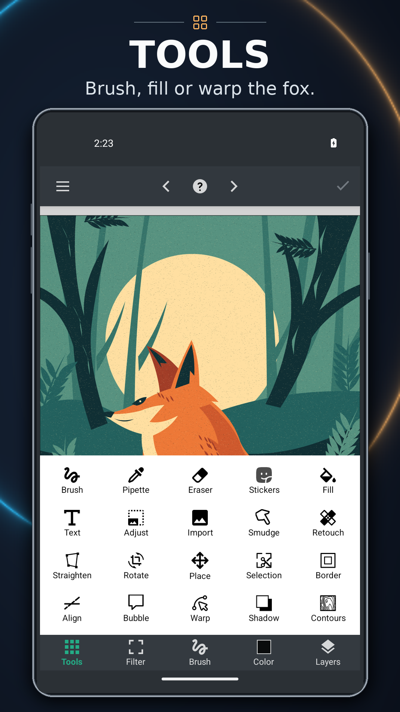
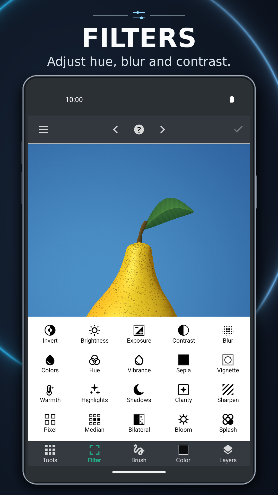

# Zaint

Draw, retouch, and make images your own. Zaint is a free, open-source image editor for Android, combining drawing tools, layers, and photo effects in one creative workspace.

- **Draw freely:** brushes, pencil, marker, calligraphy, lines, and arrows.
- **Build with layers:** import images, arrange, transform, duplicate, and merge.
- **Make it expressive:** styled and curved text, stickers, speech bubbles, fills, and gradients.
- **Refine the details:** selections, eraser, smudge, warp, and color and lighting adjustments.
- **Keep creating:** save editable `.znt` projects or export PNG and JPG images.

  
  

## License

Zaint is licensed under the [GNU General Public License v3.0](LICENSE).
[Project and source code](https://github.com/zwegen/zaint).
